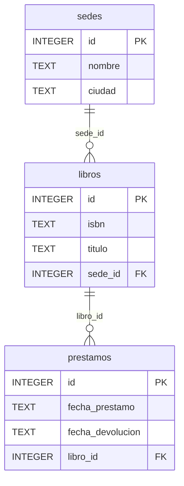

# Gestión de Biblioteca


Aplicación de consola en Java que gestiona **sedes de biblioteca, libros y préstamos** y guarda todo en una base de datos SQLite local, accediendo con JDBC puro (sin ORM ni frameworks).

Es la práctica JDBC de **Acceso a Datos** (2º de DAM). El enunciado pedía un modelo guiado por dominio (DDD), el patrón Repositorio y una base de datos relacional, partiendo de dos interfaces genéricas que no se podían modificar: `IRepositorio` e `IRepositorioExtend`. Aquí las implemento para tres entidades relacionadas entre sí.

## Tecnologías

| Tecnología | Uso |
|---|---|
| Java 21 | Lenguaje principal |
| Maven | Gestión de dependencias y compilación (`pom.xml`, sin wrapper) |
| SQLite + `org.xerial:sqlite-jdbc:3.54.1.0` | Base de datos embebida y su driver JDBC |
| JDBC (`DriverManager`, `PreparedStatement`) | Acceso a datos, sin capa de abstracción adicional |

## Arquitectura

El código sigue el patrón Repositorio, organizado por capas, en el paquete base `org.palomafp.gestionbiblioteca`:

```
src/main
├── java/org/palomafp/gestionbiblioteca
│   ├── domain
│   │   ├── SedeBiblioteca, Libro, Prestamo   # entidades
│   │   ├── Isbn                              # objeto valor
│   │   ├── IRepositorio, IRepositorioExtend  # contratos genéricos del enunciado
│   │   ├── IRepositorioSede / Libro / Prestamo
│   │   └── RepositorioException              # excepción propia (unchecked)
│   ├── infrastructure
│   │   ├── DatabaseConnection                # carga de propiedades, conexión y creación del esquema
│   │   └── RepositorioSede / Libro / PrestamoJdbcImpl
│   └── application
│       └── Main                              # demo que recorre todas las operaciones
└── resources
    ├── database.properties                   # URL de conexión
    └── schema.sql                            # tablas
```

- **`domain`** no sabe nada de JDBC. Contiene las entidades con sus validaciones, `Isbn` como objeto valor inmutable y las interfaces de los repositorios.
- **`infrastructure`** implementa esas interfaces con JDBC. Cada repositorio abre su conexión, usa `PreparedStatement` cuando hay parámetros y convierte las `SQLException` en `RepositorioException`, para que el dominio no dependa de `java.sql`.
- **`application`** es solo un `Main` de demostración. No hay capa de servicios ni casos de uso.
- Los recursos JDBC se cierran con try-with-resources y cada operación abre y cierra su propia conexión.

## Modelo de datos



- Una **sede** tiene muchos **libros** y un **libro** tiene muchos **préstamos**. Las claves foráneas llevan `ON DELETE CASCADE`: al borrar una sede se borran sus libros y, en cadena, sus préstamos.
- Las claves primarias son `INTEGER PRIMARY KEY AUTOINCREMENT`, y los repositorios recuperan el id generado con `RETURN_GENERATED_KEYS`.
- Las fechas se guardan como texto ISO-8601. `fecha_devolucion` es la única columna que admite `NULL`, y significa que el préstamo sigue activo.
- **Cómo se crea la base de datos:** `Main` llama a `DatabaseConnection.initSchema()` al arrancar, que lee `schema.sql` del classpath y ejecuta sus sentencias (`CREATE TABLE IF NOT EXISTS`). El fichero `biblioteca.db` aparece solo, en el directorio desde el que ejecutes la aplicación, y no hace falta incluirlo en el repo.
- La URL de `database.properties` es `jdbc:sqlite:biblioteca.db?foreign_keys=on`. El parámetro importa: SQLite trae las claves foráneas desactivadas por defecto, y sin él el borrado en cascada no funcionaría.

## Funcionalidades

**Operaciones comunes** (las tres entidades implementan `IRepositorio` e `IRepositorioExtend`):

- `count`, `existsById`, `findById`, `findAll`, `findByIdOptional`, `findAllToList`.
- `save`: inserta si la entidad no tiene id y actualiza si ya existe. Si el id no existe en la base de datos, lanza `RepositorioException`.
- `deleteById` y `deleteAll`.

**Consultas propias de cada repositorio:**

| Repositorio | Métodos |
|---|---|
| `IRepositorioSede` | `findByCiudad`, `contarLibrosEnSede` |
| `IRepositorioLibro` | `findBySedeId`, `findByTituloContaining` (búsqueda con `LIKE`) |
| `IRepositorioPrestamo` | `findPrestamosByLibroId`, `findPrestamosActivos`, `cerrarPrestamoHoy` |

**Reglas de dominio validadas en las entidades:**

- `SedeBiblioteca`: nombre y ciudad no pueden estar vacíos.
- `Libro`: ISBN no nulo, título no vacío y sede obligatoria.
- `Isbn`: formato de 10 o 13 caracteres por expresión regular (no calcula el dígito de control).
- `Prestamo`: fecha de préstamo y libro obligatorios, y la devolución no puede ser anterior al préstamo.

**Lo que no hay:** transacciones explícitas (cada sentencia se confirma sola), usuarios o socios, reservas ni tests automáticos.

## Requisitos y ejecución

Necesitas **JDK 21**, **Maven 3** y Git (o un IDE con soporte Maven, como IntelliJ IDEA).

```bash
git clone https://github.com/<usuario>/gestion-biblioteca.git
cd gestion-biblioteca
mvn compile exec:java -Dexec.mainClass="org.palomafp.gestionbiblioteca.application.Main"
```

También puedes abrir el proyecto como Maven en tu IDE y ejecutar `Main` directamente.

> **Ojo:** `Main` vacía las tres tablas al empezar para que la demo sea reproducible. No lo uses sobre datos que quieras conservar. Para empezar de cero, borra `biblioteca.db`.

## Mejoras futuras

- **Transacciones:** envolver las operaciones compuestas (`save` con actualización y `cerrarPrestamoHoy`) en `setAutoCommit(false)` con `commit` y `rollback`. Hoy comprueban y luego actualizan en conexiones separadas.
- **Integridad en la base de datos:** añadir `UNIQUE` sobre `isbn` e índices en `sede_id` y `libro_id`, para no depender solo de las validaciones del dominio.
- **Capa de servicios y tests:** crear servicios de aplicación con casos de uso reales (prestar, devolver) y pruebas JUnit sobre una base de datos en memoria, además de un pool de conexiones o un `DataSource` en lugar de abrir una conexión por operación.

## Autor

Adrián Stephano Alvarado Dávila · Acceso a Datos, 2º DAM
